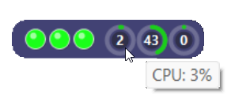

# PulsePill

A compact, always-on-top desktop widget that keeps network availability, network traffic, and hardware usage visible at a glance.

 

## Features

•	Network availability: Monitor configured hosts with color-coded indicators based on ping response time.
•	Network traffic: Track download and upload usage on a selected network interface, with configurable maximum speeds.
•	Hardware monitoring: View CPU, RAM, and GPU usage in compact circular gauges.
•	GPU selection: Choose a specific graphics adapter or monitor all detected GPUs.
•	Lightweight overlay: A discreet, movable widget designed to stay visible without cluttering the desktop.
•	Saved settings: Server and monitoring preferences are stored in the current user’s profile.

## About the Author

- **Author:** Nicolas DUBOL
- **Version:** 1.2

## License & Intellectual Property

Copyright © 2026 Nicolas DUBOL. All rights reserved.

## Support the Project

If you find PulsePill useful and would like to support its development:

This project and its source code are proprietary. No part of this software may be copied, modified, distributed, reverse-engineered, or used in derivative works without the explicit written permission of the copyright holder.
